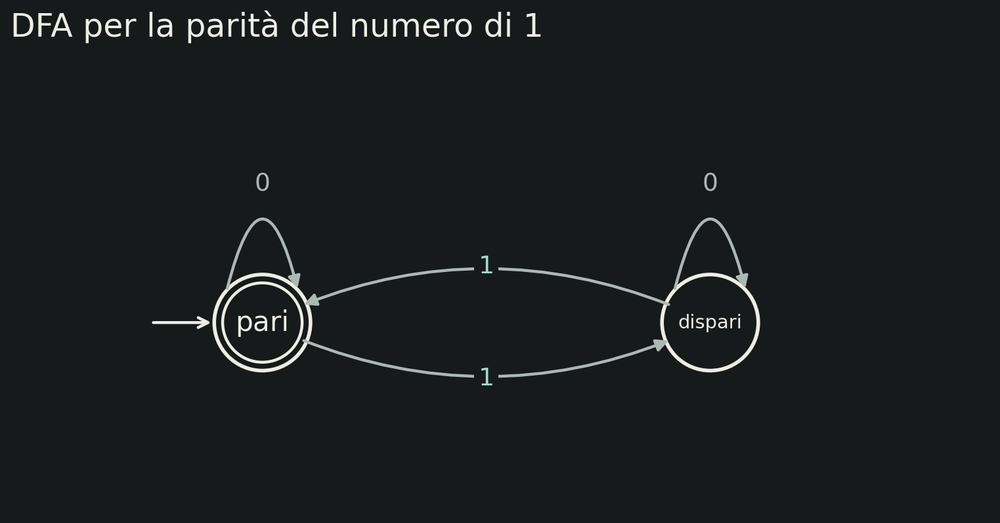
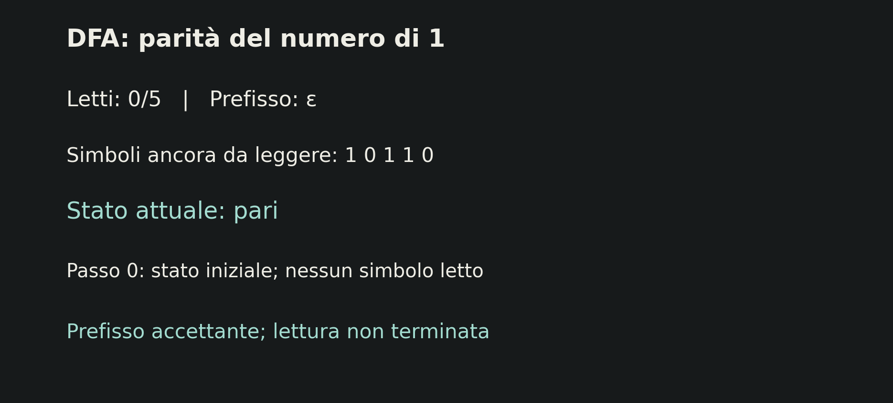
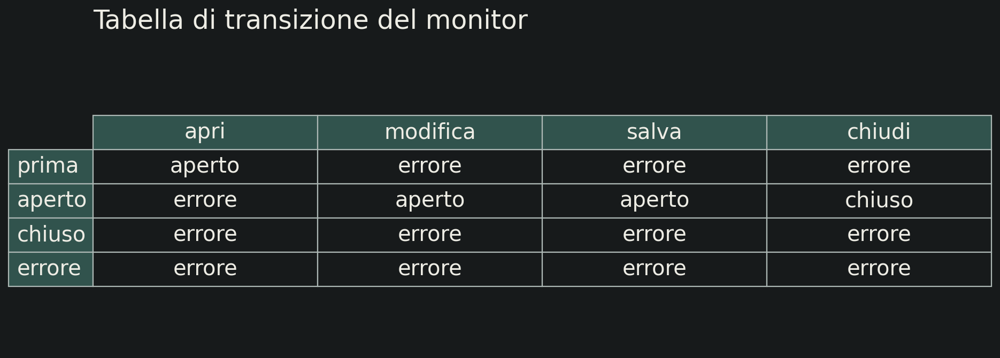
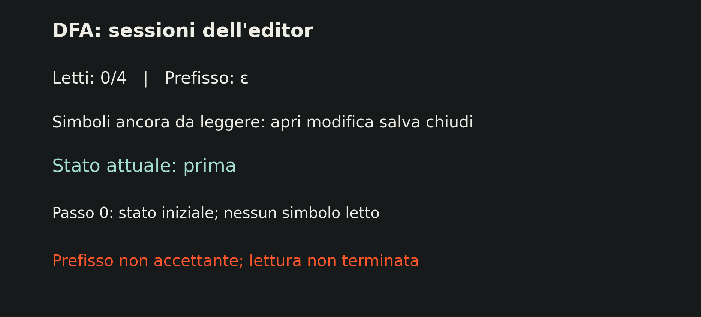
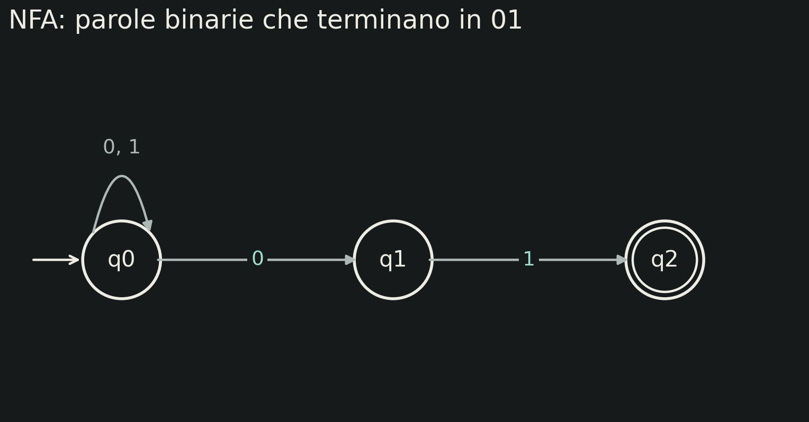
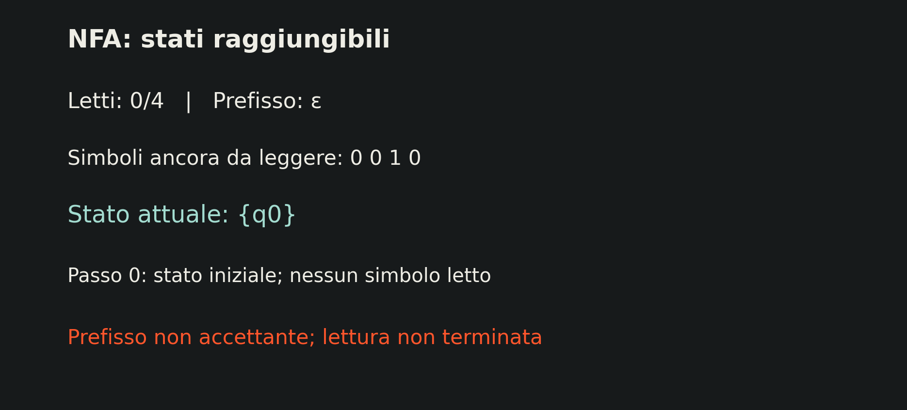
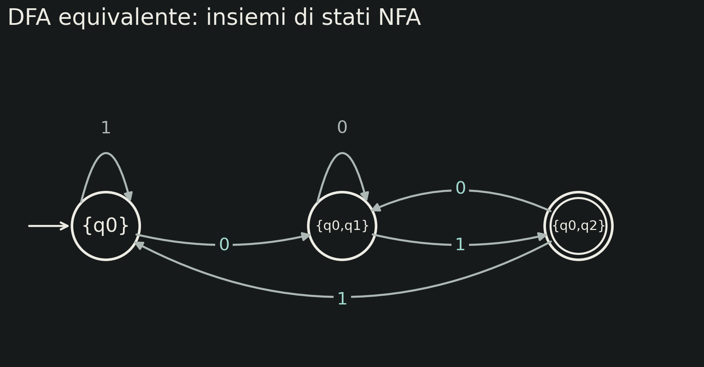

## Automi finiti e linguaggi regolari {#scena-01 .scrollable}

<p class="scene-meta">01 / 31 · pp. 9-10</p>

Una sequenza di eventi descrive un comportamento. Un automa decide se quella sequenza soddisfa una proprietà.

**Percorso:** parole e linguaggi → DFA → NFA → costruzione per sottoinsiemi.

**Obiettivo:** simulare un automa e spiegare perché DFA e NFA riconoscono gli stessi linguaggi su parole finite.

## Alfabeto e parola {#scena-02 .scrollable}

<p class="scene-meta">02 / 31 · §1.1, pp. 10-11</p>

Un **alfabeto** è un insieme finito non vuoto di simboli.

Una **parola** è una sequenza finita di simboli dell'alfabeto.

$$ A=\{0,1\},\qquad w=0101,\qquad |w|=4 $$

La parola vuota $\varepsilon$ ha lunghezza zero. Un evento come `apri` può essere un unico simbolo: non va confuso con i suoi caratteri.

## Linguaggi su un alfabeto {#scena-03 .scrollable}

<p class="scene-meta">03 / 31 · §1.1, p. 11</p>

$$ L\subseteq A^* $$

L'alfabeto stabilisce cosa possiamo scrivere. Il linguaggio stabilisce quali parole soddisfano la proprietà scelta.

**Esempio:** parole binarie che terminano con `01`.

`01`, `101`, `0001` appartengono al linguaggio; `ε`, `10`, `011` no.

## Concatenazione di parole e linguaggi {#scena-04 .scrollable}

<p class="scene-meta">04 / 31 · §1.1, p. 11</p>

$$ u=01,\quad v=1,\qquad uv=011,\quad vu=101 $$

$$ |uv|=|u|+|v|,\qquad \varepsilon w=w\varepsilon=w $$

Per due linguaggi, $L_1L_2$ contiene le concatenazioni di una parola del primo con una del secondo.

**Da distinguere:** $L\{\varepsilon\}=L$, mentre $L\varnothing=\varnothing$.

## Stella di Kleene e caso vuoto {#scena-05 .scrollable}

<p class="scene-meta">05 / 31 · §1.1, p. 12</p>

$$ W^0=\{\varepsilon\},\qquad W^*=\bigcup_{n\geq0}W^n $$

$W^*$ permette **zero o più blocchi**; $W^+$ richiede **almeno un blocco**.

Per $W=\{01\}$: `ε`, `01`, `0101`, … appartengono a $W^*$.

Attenzione: se $\varepsilon\in W$, anche $W^+$ contiene $\varepsilon$. Un blocco non è necessariamente non vuoto.

## Stati e memoria finita {#scena-06 .scrollable}

<p class="scene-meta">06 / 31 · §1.2, p. 12</p>

Per sapere se il numero di `1` è pari, non serve memorizzare la parola né il conteggio esatto.

Bastano due situazioni:

- `pari`: finora un numero pari di `1`;
- `dispari`: finora un numero dispari di `1`.

Leggere `1` cambia la parità; leggere `0` la conserva.

## Definizione di automa deterministico {#scena-07 .scrollable}

<p class="scene-meta">07 / 31 · §1.2, p. 13</p>

$$ \mathcal A=(Q,A,\delta,q_0,F) $$

- $Q$: insieme finito degli stati; $A$: alfabeto.
- $q_0\in Q$: stato iniziale; $F\subseteq Q$: stati accettanti.
- $\delta:Q\times A\to Q$: una scelta determinata per ogni coppia stato-simbolo.

Lo stato iniziale non deve essere necessariamente accettante.

## DFA per la parità {#scena-08 .scrollable}

<p class="scene-meta">08 / 31 · §1.2, pp. 12-13</p>

La freccia esterna indica lo stato iniziale. Il doppio cerchio indica uno stato accettante.

Per ogni stato devono esserci le transizioni per entrambi i simboli `0` e `1`.

{.lesson-figure}

## Funzione di transizione estesa {#scena-09 .scrollable}

<p class="scene-meta">09 / 31 · §1.2, p. 14</p>

$$ \widehat\delta(q,\varepsilon)=q $$

$$ \widehat\delta(q,wx)=\delta(\widehat\delta(q,w),x) $$

Una parola di lunghezza $n$ genera una run con $n+1$ stati, contando quello iniziale.

La decisione riguarda lo stato **dopo tutta la parola**, non uno stato visitato a metà.

```python
w="10110"
run=dfa_run(PARITY,0,w)
print("Parola:",w)
print("Run:"," → ".join("pari" if q==0 else "dispari" for q in run))
print("Accettata:",run[-1]==0)
```

```
Parola: 10110
Run: pari → dispari → dispari → pari → dispari → dispari
Accettata: False
```

## Simulazione DFA {#scena-10 .scrollable}

<p class="scene-meta">10 / 31 · §1.2, pp. 12-14</p>

Il modello riconosce le parole con un numero pari di `1`.

1. In **Parola** scegli `10110`.
2. **Letti** indica quanti simboli sono già stati letti; `0` mostra lo stato iniziale.
3. Porta **Letti** a `1`, poi a `2`: lo stato passa da `dispari` a `dispari`, perché il secondo simbolo è `0`.
4. A `5` la parola è completa: viene rifiutata.

Cambiare parola riporta il cursore a zero.

{.lesson-figure}

## DFA per le sessioni di un editor {#scena-11 .scrollable}

<p class="scene-meta">11 / 31 · §1.2, p. 13</p>

Consideriamo quattro eventi: `apri`, `modifica`, `salva`, `chiudi`.

Una sessione completata apre una volta, può modificare e salvare, poi chiude.

La memoria necessaria è la fase: **prima**, **aperto**, **chiuso**, **errore**.

Solo `chiuso` è accettante: un editor ancora aperto non è una sessione completata.

## Tabella completa del monitor {#scena-12 .scrollable}

<p class="scene-meta">12 / 31 · §1.2, pp. 13-15</p>

Ogni cella della tabella definisce il prossimo stato.

Da `errore` non si torna a una sessione valida. Anche un evento dopo `chiudi` porta a `errore`.

{.lesson-figure}

## Simulazione dell'editor {#scena-13 .scrollable}

<p class="scene-meta">13 / 31 · §1.2, p. 13</p>

Il modello controlla l'ordine degli eventi dell'editor.

1. In **Traccia** scegli **Dopo la chiusura**: `apri chiudi salva`.
2. Muovi **Letti** da `0` a `3`: ogni passo consuma un evento intero.
3. A `2` lo stato è `chiuso`: il prefisso è una sessione completata.
4. A `3`, `salva` porta a `errore`: la traccia completa è rifiutata.

La riga **Ultimo passo** indica l'evento che ha cambiato lo stato.

{.lesson-figure}

## Transizioni mancanti: lo stato pozzo {#scena-14 .scrollable}

<p class="scene-meta">14 / 31 · §1.2.1, pp. 14-15</p>

Un DFA formale ha una funzione di transizione totale.

Per completare un disegno parziale, aggiungiamo uno stato **non accettante** $\bot$.

Le transizioni mancanti vanno a $\bot$; da $\bot$ ogni simbolo ritorna a $\bot$.

**Non sostituire una freccia mancante con un autoanello:** potresti cambiare il linguaggio.

## Proprietà di risposta e conteggio esatto {#scena-15 .scrollable}

<p class="scene-meta">15 / 31 · §1.2, pp. 13-14</p>

Proprietà: ogni `0` deve avere almeno un `1` in una posizione successiva.

Un solo `1` può risolvere più `0` pendenti: `0001` va bene.

Basta ricordare **nessun obbligo** oppure **obbligo pendente**. Su `0` siamo pendenti; su `1` torniamo senza obblighi.

Questa proprietà non richiede di associare un `1` distinto a ogni `0`.

## NFA: una relazione di transizione {#scena-16 .scrollable}

<p class="scene-meta">16 / 31 · §1.3, pp. 15-16</p>

$$ \mathcal N=(Q,A,\Delta,q_0,F) $$

Per una coppia stato-simbolo, $\Delta(q,x)$ è un **insieme** di possibili successori: può avere zero, uno o più elementi.

$$ \Delta:Q\times A\to 2^Q $$

In questo capitolo consideriamo NFA senza transizioni $\varepsilon$.

## NFA per il suffisso 01 {#scena-17 .scrollable}

<p class="scene-meta">17 / 31 · §1.3, p. 17</p>

Un NFA può continuare a leggere in `q0` oppure, su `0`, iniziare un tentativo in `q1`.

Da `q1`, un `1` porta a `q2`, accettante. Da `q2` non partono transizioni.

Il tentativo riesce soltanto se **la parola termina** appena raggiunto `q2`.

{.lesson-figure}

## Simulare tutti i rami con un insieme {#scena-18 .scrollable}

<p class="scene-meta">18 / 31 · §1.3, pp. 16-17</p>

$$ S_0=\{q_0\},\qquad S_{i+1}=\bigcup_{q\in S_i}\Delta(q,w_i) $$

Su `001`, gli insiemi sono:

`{q0}` → `{q0,q1}` → `{q0,q1}` → `{q0,q2}`.

Se due rami raggiungono lo stesso stato, lo registriamo una sola volta.

```python
w="001"
print(" → ".join(subset_name(s) for s in nfa_run(ENDING,"q0",w)))
```

```
{q0} → {q0, q1} → {q0, q1} → {q0, q2}
```

## Simulazione NFA {#scena-19 .scrollable}

<p class="scene-meta">19 / 31 · §1.3, pp. 16-17</p>

Il modello riconosce le parole che terminano con `01`.

1. In **Parola** scegli `0010` e porta **Letti** a `3`.
2. Lo stato attuale è l'insieme `{q0,q2}`: il prefisso `001` è accettante perché contiene `q2`.
3. Porta **Letti** a `4`: rimangono `{q0,q1}`. La parola completa è rifiutata.

Le parentesi graffe elencano tutti gli stati raggiungibili, non un singolo ramo scelto.

{.lesson-figure}

## Condizione di accettazione di un NFA {#scena-20 .scrollable}

<p class="scene-meta">20 / 31 · §1.3, p. 17</p>

$$ w\in L(\mathcal N)\quad\Longleftrightarrow\quad S_{|w|}\cap F\neq\varnothing $$

Basta **almeno uno** stato finale nell'insieme raggiunto dopo tutta la parola.

Non è necessario che tutti i rami accettino. Alcuni possono morire o finire in stati non accettanti.

## Costruzione per sottoinsiemi {#scena-21 .scrollable}

<p class="scene-meta">21 / 31 · §1.4, pp. 18-19</p>

Nell'NFA del suffisso `01`, dopo `00` sono possibili `q0` e `q1`.

Il DFA li ricorda con **un solo stato**, chiamato `{q0,q1}`. Leggendo `1`, da `q0` si arriva a `q0` e da `q1` a `q2`: il nuovo stato del DFA è `{q0,q2}`.

In generale, uno stato del DFA è un insieme $S$ di stati NFA. Su un simbolo $x$, raccogliamo tutti i loro successori:

$$ \delta_D(S,x)=\bigcup_{q\in S}\Delta(q,x) $$

$$ Q_D=2^Q,\qquad q_{0,D}=\{q_0\} $$

## Costruire soltanto gli insiemi raggiungibili {#scena-22 .scrollable}

<p class="scene-meta">22 / 31 · §1.4, pp. 18-20</p>

Partiamo da `{q0}`. Per ogni insieme scoperto, calcoliamo il successore su `0` e su `1`.

Accodiamo un insieme solo se è nuovo. Ci fermiamo quando non restano insiemi da esplorare.

Nel nostro esempio si raggiungono **3 insiemi**, su un massimo teorico di **8**.

```python
for subset in sorted(SUBSETS,key=lambda s:(len(s),sorted(s))):
    print(subset_name(subset), "| 0 →",subset_name(DET[(subset,"0")]),
          "| 1 →",subset_name(DET[(subset,"1")]),"| finale:",subset in DET_FINAL)
print("Raggiungibili:",len(SUBSETS),"/ massimo:",2**3)
```

```
{q0} | 0 → {q0, q1} | 1 → {q0} | finale: False
{q0, q1} | 0 → {q0, q1} | 1 → {q0, q2} | finale: False
{q0, q2} | 0 → {q0, q1} | 1 → {q0} | finale: True
Raggiungibili: 3 / massimo: 8
```

## Il DFA risultante {#scena-23 .scrollable}

<p class="scene-meta">23 / 31 · §1.4, pp. 18-20</p>

I tre stati corrispondono a tre insiemi possibili.

È accettante l'insieme che contiene `q2`. Le frecce definiscono una funzione totale sul grafo raggiungibile.

{.lesson-figure}

## Dimostrazione: l'invariante {#scena-24 .scrollable}

<p class="scene-meta">24 / 31 · §1.4, pp. 19-20</p>

Dopo `00`, l'NFA può trovarsi in `q0` oppure in `q1`; il DFA è nell'unico stato `{q0,q1}`.

**Proprietà da dimostrare:** dopo ogni parola $w$, lo stato del DFA coincide con l'insieme di tutti gli stati raggiungibili nell'NFA:

$$ \widehat\delta_D(\{q_0\},w)=\widehat\Delta(q_0,w) $$

**Base:** prima di leggere simboli, l'NFA è solo in `q0` e il DFA parte da `{q0}`. Quindi per $w=\varepsilon$ la proprietà vale.

Resta da provare che ogni nuovo simbolo conserva questa corrispondenza.

## Dimostrazione: il passo induttivo {#scena-25 .scrollable}

<p class="scene-meta">25 / 31 · §1.4, pp. 19-20</p>

**Esempio:** abbiamo letto `00` e l'insieme comune è `{q0,q1}`. Arriva `1`:

- da `q0`, su `1`, si raggiunge `q0`;
- da `q1`, su `1`, si raggiunge `q2`.

L'NFA può quindi trovarsi in `{q0,q2}`; il DFA passa proprio allo stato `{q0,q2}`.

**Passo generale:** supponiamo che dopo una parola qualsiasi $w$ i due modelli descrivano lo stesso insieme $S$. Sul simbolo successivo $x$, il DFA calcola:

$$ \delta_D(S,x)=\bigcup_{q\in S}\Delta(q,x) $$

- **Nessuno stato perso:** ogni percorso NFA su $wx$ passa da uno stato di $S$ e fa un passo su $x$.
- **Nessuno stato inventato:** ogni successore raccolto prolunga su $x$ un percorso NFA già possibile dopo $w$.

La corrispondenza vale anche dopo $wx$: questo conclude l'induzione.

## Equivalenza e numero di stati {#scena-26 .scrollable}

<p class="scene-meta">26 / 31 · §1.4, pp. 18-20</p>

Dopo `001`, l'insieme raggiunto è `{q0,q2}`. L'NFA accetta perché `q2` è finale; anche il DFA accetta perché il suo stato contiene `q2`.

In generale, rendiamo accettanti esattamente gli stati-insieme che contengono almeno uno stato finale NFA:

$$ F_D=\{S\subseteq Q:S\cap F\neq\varnothing\} $$

L'invariante garantisce lo stesso insieme dopo ogni parola finita. Con questa regola, i due automi danno sempre lo stesso verdetto: $L(D)=L(\mathcal N)$.

Con $n$ stati NFA ci sono al massimo $2^n$ sottoinsiemi. Nel nostro esempio ne raggiungiamo **3 su 8**; nel caso peggiore la crescita può essere esponenziale.

## Definizione di linguaggio regolare {#scena-27 .scrollable}

<p class="scene-meta">27 / 31 · §1.4.1, pp. 20-21</p>

Un linguaggio è **regolare** se un DFA lo riconosce. Equivalentemente, può riconoscerlo un NFA.

Il numero di stati è finito e fissato prima di leggere la parola.

**Contrasto:** riconoscere lo stesso numero di `0` iniziali e `1` finali richiederebbe distinguere conteggi arbitrariamente grandi.

$$ L_=\{0^n1^n:n\geq0\} $$

## Perché il conteggio esatto non è regolare {#scena-28 .scrollable}

<p class="scene-meta">28 / 31 · §1.4.1, p. 21</p>

Supponiamo, per assurdo, che un DFA con $k$ stati riconosca $L_=$.

**Esempio di collisione:** se `00` e `00000` arrivassero nello stesso stato, aggiungere `11` darebbe lo stesso verdetto. Ma `0011` va accettata e `0000011` va rifiutata.

**Una collisione è inevitabile:** i $k+1$ prefissi $\varepsilon,0,\ldots,0^k$ devono distribuirsi in soli $k$ stati. Due di essi, $0^i$ e $0^j$ con $i<j$, finiscono nello stesso stato.

Da quello stato, leggere la stessa continuazione $1^i$ porta allo stesso stato di arrivo. Eppure:

$$ 0^i1^i\in L_=,\qquad 0^j1^i\notin L_= $$

**Contraddizione:** il DFA dà lo stesso verdetto a due parole che richiedono verdetti diversi.

## Esercizi di verifica {#scena-29 .scrollable}

<p class="scene-meta">29 / 31 · Esercizi, p. 22</p>

1. Simula la parità su `11010`: qual è la run completa?
2. Nell'editor, a quale evento `apri salva chiudi modifica` diventa invalida?
3. Per l'NFA del suffisso `01`, cosa accade su `0010`?
4. Progetta un DFA che riconosce la sottostringa `10` in qualunque posizione.

**Metodo Feynman:** spiega a voce perché uno stato DFA può rappresentare un insieme senza introdurre nuove scelte.

## Soluzioni e controllo degli esempi {#scena-30 .scrollable}

<p class="scene-meta">30 / 31 · Esercizi, p. 22</p>

1. Run della parità: `pari → dispari → pari → pari → dispari → dispari`; rifiutata.
2. `modifica` dopo `chiudi` porta a `errore`.
3. Dopo `0010` restano `{q0,q1}`: nessuno stato finale.
4. Per `10`: ricorda nessun `1` utile, ultimo simbolo `1`, oppure sottostringa già trovata. Quest'ultimo stato è accettante e assorbente.

```python
for w in words(max_len=7):
    assert (dfa_run(PARITY,0,w)[-1]==0)==(w.count("1")%2==0)
    nfa_ok=bool(nfa_run(ENDING,"q0",w)[-1]&NFA_FINAL)
    dfa_ok=dfa_run(DET,DET_START,w)[-1] in DET_FINAL
    assert nfa_ok==dfa_ok==w.endswith("01")
assert dfa_run(EDITOR,"prima",["apri","salva","chiudi"])[-1]=="chiuso"
assert dfa_run(EDITOR,"prima",["apri","salva","chiudi","modifica"])[-1]=="errore"
SUBSTRING={(0,"0"):0,(0,"1"):1,(1,"0"):2,(1,"1"):1,(2,"0"):2,(2,"1"):2}
for w in words(max_len=7):
    assert (dfa_run(SUBSTRING,0,w)[-1]==2)==("10" in w)
print("Verificati tutti i 255 input binari di lunghezza fino a 7.")
print("Parità, suffisso 01, determinizzazione e sottostringa 10: controlli passati.")
```

```
Verificati tutti i 255 input binari di lunghezza fino a 7.
Parità, suffisso 01, determinizzazione e sottostringa 10: controlli passati.
```

## Riepilogo del capitolo {#scena-31 .scrollable}

<p class="scene-meta">31 / 31 · Riepilogo, p. 22</p>

- Una parola è un input; un linguaggio è un insieme di input.
- Il DFA conserva un solo stato; l'NFA può avere più run.
- L'NFA accetta se almeno una run termina in uno stato finale.
- La determinizzazione conserva tutti gli stati possibili in un insieme.
- Memoria finita non significa poter riconoscere ogni linguaggio.

**Prossimo passo:** descrivere i linguaggi regolari con espressioni regolari.
