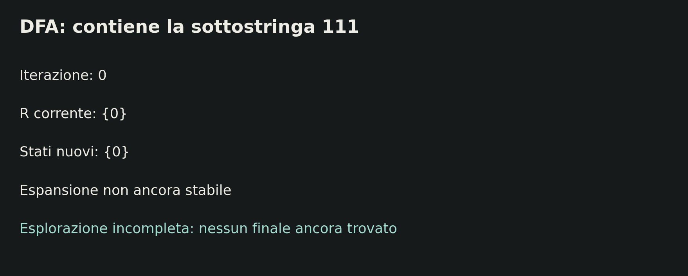
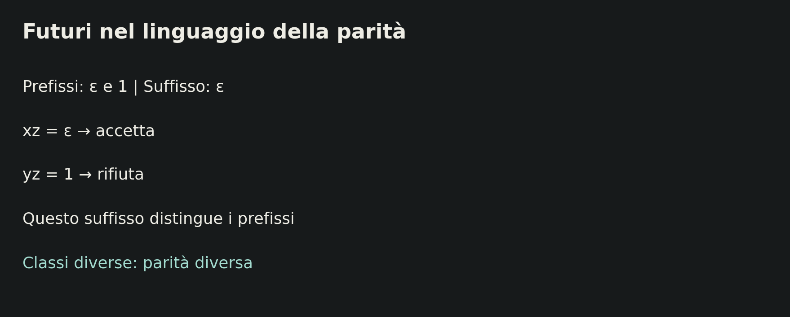

## Linguaggi regolari e problemi di decisione {#scena-01 .scrollable}

<p class="scene-meta">01 / 50 · Cap. 2 · pp. 23-24</p>

**VVT · Lezione 2 · Capitolo 2**

Nel capitolo 1 abbiamo introdotto gli automi a stati finiti: un modello **operazionale** che descrive come scansionare una parola passo dopo passo.

Questo capitolo introduce tre prospettive complementari:

1. **Sintassi algebrica (dichiarativa):** le espressioni regolari e l'equivalenza di Kleene.
2. **Composizione modulare:** le proprietà di chiusura booleana (unione, intersezione, complemento).
3. **Verifica algoritmica:** i problemi di decisione (inclusione, vuotezza, equivalenza).

Conclude la **prospettiva di Myhill–Nerode**: quanti stati servono davvero e qual è il DFA canonico minimo.

**Filo conduttore:** la *riduzione* di quesiti semantici complessi a controlli di raggiungibilità su grafo.

## Richiamo: accettazione su parole finite {#scena-02 .scrollable}

<p class="scene-meta">02 / 50 · Cap. 2 · introduzione, pp. 23-24</p>

Un DFA ha una sola run per ogni parola; un NFA può averne nessuna, una o molte.

Una parola è accettata se **almeno una run** termina in uno stato finale in $F$, dopo aver consumato l'intero input:

$$ L(\mathcal{A})\subseteq\Sigma^* $$

- $\Sigma$ indica l'alfabeto di lavoro (spesso $\{0,1\}$ o un insieme di eventi del sistema).
- $\varepsilon$ denota la parola vuota ($|\varepsilon|=0$).
- Il complemento $\overline{L}=\Sigma^*\setminus L$ è sempre relativo all'alfabeto dichiarato $\Sigma$.

## Dalla macchina alla formula: sintassi dichiarativa {#scena-03 .scrollable}

<p class="scene-meta">03 / 50 · Cap. 2 · §2.1.1, pp. 24-25</p>

Disegnare un automa è un atto **operazionale**: descrive cosa fa la macchina a ogni passo di computazione, non come è fatta la parola.

Per specificare proprietà, interrogare tracce e comporre requisiti, è preferibile una sintassi **algebrica e dichiarativa**: le **espressioni regolari**.

Le espressioni **ristrette** su $\Sigma$ partono dai casi atomici:

$$ \varnothing,\qquad \varepsilon,\qquad a\in\Sigma $$

e si compongono induttivamente tramite:

$$ r+s \quad\text{(unione)},\qquad rs \quad\text{(concatenazione)},\qquad r^* \quad\text{(stella di Kleene)} $$

Precedenza: la stella precede la concatenazione, che precede l'unione. Le parentesi sciolgono le ambiguità.

## Semantica delle espressioni regolari {#scena-04 .scrollable}

<p class="scene-meta">04 / 50 · Cap. 2 · §2.1.1, pp. 24-25</p>

La semantica associa a ogni espressione regolare $r$ il linguaggio formale $L(r)\subseteq\Sigma^*$:

$$ L(\varnothing)=\varnothing,\quad L(\varepsilon)=\{\varepsilon\},\quad L(a)=\{a\} $$

$$ L(r+s)=L(r)\cup L(s) $$

$$ L(rs)=L(r)L(s),\qquad L(r^*)=L(r)^* $$

$\varnothing$ denota il linguaggio vuoto (nessuna parola); $\varepsilon$ denota il linguaggio contenente solo la parola vuota ($\{\varepsilon\}\neq\varnothing$).

La stella $r^*$ ammette sempre **zero o più ripetizioni finite**, quindi $\varepsilon\in L(r^*)$ per qualsiasi espressione $r$.

## Esempi di espressioni: suffisso e parità {#scena-05 .scrollable}

<p class="scene-meta">05 / 50 · Cap. 2 · §2.1.1, p. 25</p>

$$ (0+1)^*01 $$

Descrive le parole che terminano con `01`: accetta `01`, `1101`; rifiuta `ε`, `010`.

$$ 0^*(10^*10^*)^* $$

Descrive le parole con un numero pari di `1`: ogni blocco ripetuto contribuisce due `1`. Sono incluse `ε` e tutte le parole composte solo da `0`.

L'espressione descrive la *struttura* della parola; il DFA descrive come *scansionarla*.

## Esempio guida: la sessione dell'editor {#scena-06 .scrollable}

<p class="scene-meta">06 / 50 · Cap. 2 · §2.1.1, p. 25</p>

Nel nostro monitor software per un editor di testo, l'alfabeto di eventi è $\Sigma_{\mathrm{edit}}=\{\texttt{apri},\texttt{modifica},\texttt{salva},\texttt{chiudi}\}$.

La proprietà delle sessioni finite corrette si scrive direttamente come espressione regolare ristretta:

$$ r_{\mathrm{sessione}}=\texttt{apri}\;(\texttt{modifica}+\texttt{salva})^*\,\texttt{chiudi} $$

I tre blocchi riflettono il ciclo vitale del documento:
1. Inizio: apertura del documento una sola volta;
2. Lavoro: sequenza arbitraria finita di modifiche e salvataggi;
3. Termine: chiusura ordinata del file.

DFA ed espressione regolare specificano **lo stesso identico insieme di tracce** a due livelli di astrazione complementari: macchina a stati vs specifica dichiarativa.

## Espressioni generali e star-free {#scena-07 .scrollable}

<p class="scene-meta">07 / 50 · Cap. 2 · §2.1.1, pp. 25-26</p>

Le espressioni **generali** aggiungono intersezione e complemento direttamente nella sintassi:

$$ L(r\cap s)=L(r)\cap L(s),\qquad L(\overline{r})=\Sigma^*\setminus L(r) $$

Le espressioni **star-free** ammettono questi operatori booleani, ma **vietano la stella**: nessuna iterazione libera.

**Gerarchia espressiva:**
- *Generali = Ristrette:* i connettivi booleani sono una comodità sintattica, ma non aumentano il potere espressivo (si compilano via automi).
- *Star-free < Ristrette:* le star-free definiscono una classe strettamente più piccola (i linguaggi aperiodici / logica del primo ordine). Non possono contare modulo una costante (la parità non è star-free).

## L'obiettivo di equivalenza: il Teorema di Kleene {#scena-08 .scrollable}

<p class="scene-meta">08 / 50 · Cap. 2 · §2.1.2, pp. 26-27</p>

Qual è il legame fondamentale tra la sintassi dichiarativa delle espressioni e il modello a stati degli automi?

**Teorema di Kleene:** Un linguaggio $L\subseteq\Sigma^*$ è riconosciuto da un automa a stati finiti **se e solo se** è denotato da un'espressione regolare ristretta.

Il risultato fornisce due concreti motori algoritmici:
1. **Motore di compilazione (Espressione $\to$ Automa):** assemblaggio strutturale di sotto-automi tramite mosse silenti (costruzione di Thompson).
2. **Motore di estrazione (Automa $\to$ Espressione):** eliminazione graduale degli stati tramite programmazione dinamica.

Nella verifica software, Kleene assicura che possiamo alternare liberamente specifiche dichiarative e monitor a stati eseguibili.

## La sfida della compilazione: le transizioni ε {#scena-09 .scrollable}

<p class="scene-meta">09 / 50 · Cap. 2 · §2.1.3, pp. 27-28</p>

Per compilare un'espressione $r$ in un automa $A_r$, dobbiamo comporre ricorsivamente le macchine dei sotto-termini per $r+s$, $rs$ e $r^*$.

Comporre direttamente automi rigidi richiederebbe di ricablare a mano ogni transizione entrante negli stati finali del primo componente.

Per rendere modulare l'assemblaggio, introduciamo un connettore ideale: la **transizione $\varepsilon$** (mossa silente).

Una transizione $\varepsilon$ cambia stato **senza consumare simboli** e senza far avanzare la testina di lettura sull'input.

## Transizioni ε e composizione {#scena-10 .scrollable}

<p class="scene-meta">10 / 50 · Cap. 2 · §2.1.3, pp. 27-28</p>

Per concatenare gli automi per $\{0\}$ e $\{1\}$, colleghiamo l'uscita del primo all'ingresso del secondo con un arco $\varepsilon$.

Non serve riprogettare gli stati interni: il controllo salta al secondo automa in modo asincrono.

Solo l'uscita dell'ultimo frammento resta accettante; la freccia esterna indica l'iniziale.

{.lesson-figure}

## Chiusura ε come punto fisso {#scena-11 .scrollable}

<p class="scene-meta">11 / 50 · Cap. 2 · §2.1.3, p. 28</p>

$\operatorname{ECl}(S)$ contiene tutti gli stati raggiungibili da $S$ seguendo zero o più transizioni $\varepsilon$.

Si calcola come punto fisso della sequenza crescente:

$$ X_0=S,\qquad X_{i+1}=X_i\cup\bigcup_{q\in X_i}\Delta(q,\varepsilon) $$

L'algoritmo si arresta quando $X_{i+1}=X_i$. Nel diagramma precedente:

$$ \operatorname{ECl}(\{u\})=\{u,v\} $$

Proprietà fondamentale: $S\subseteq\operatorname{ECl}(S)$ sempre (cammino nullo di zero passi $\varepsilon$).

## Simulazione di un ε-NFA {#scena-12 .scrollable}

<p class="scene-meta">12 / 50 · Cap. 2 · §2.1.3, pp. 28-29</p>

In un $\varepsilon$-NFA, l'insieme degli stati attivi si espande con la chiusura $\varepsilon$ prima di iniziare e dopo ogni simbolo letto:

1. In **Parola** scegli `01`; **Letti** conta i simboli consumati, da `0` a `2`, inizialmente `0`.
2. A `0` l'insieme attivo è $\{s\}$. A `1` diventa $\{u,v\}$: è stato consumato solo `0`.
3. A `2` rimane $\{f\}$ e la parola è accettata.
4. Scegli `0`: il cursore si azzera e il massimo diventa `1`. Al termine $\{u,v\}$ non contiene finali.

Il caso `ε` termina subito in $\{s\}$ ed è rifiutato.

{.lesson-figure}

## Eliminare le transizioni ε {#scena-13 .scrollable}

<p class="scene-meta">13 / 50 · Cap. 2 · §2.1.3, pp. 29-30</p>

Manteniamo gli stati $Q$, ma ogni passo ordinario assorbe i passi $\varepsilon$ precedenti e successivi:

$$ \Delta'(q,a)=\operatorname{ECl}\left(\bigcup_{p\in\operatorname{ECl}(\{q\})}\Delta(p,a)\right) $$

Nell'esempio: $\Delta'(s,0)=\{u,v\}$ e $\Delta'(u,1)=\{f\}$.

Il nuovo NFA legge solo simboli reali. Va controllata separatamente l'accettazione della parola vuota.

## Eliminazione ε: il caso della parola vuota {#scena-14 .scrollable}

<p class="scene-meta">14 / 50 · Cap. 2 · §2.1.3, p. 30</p>

Gli stati finali rimangono $F$, con una correzione fondamentale:

$$ q_0\in F' \iff \operatorname{ECl}(q_0)\cap F\neq\varnothing $$

Se dall'iniziale $q_0$ si può raggiungere uno stato finale solo tramite mosse $\varepsilon$, l'automa originale accettava $\varepsilon$.

Rendendo finale anche $q_0$, l'NFA senza $\varepsilon$ conserva esattamente l'accettazione di $\varepsilon$.

```python
empty_example = enfa({'i','f'}, {('i', EPS): {'f'}}, 'i', {'f'})
ordinary = remove_epsilon(empty_example)
print('Finali dopo la rimozione:', names(ordinary['final']))
print('ε accettata:', bool(enfa_run(ordinary, '')[-1] & ordinary['final']))
print('0 accettata:', bool(enfa_run(ordinary, '0')[-1] & ordinary['final']))
```

```
Finali dopo la rimozione: {f, i}
ε accettata: True
0 accettata: False
```

## Thompson: casi base e invariante {#scena-15 .scrollable}

<p class="scene-meta">15 / 50 · Cap. 2 · §2.1.3, pp. 30-31</p>

L'algoritmo di Thompson compila ricorsivamente un'espressione regolare in un $\varepsilon$-NFA.

**Invariante strutturale:** ogni frammento ha:
- un solo ingresso $i$, senza transizioni entranti;
- una sola uscita accettante $f$, senza transizioni uscenti.

**Casi base:**
- $\varnothing$: ingresso e uscita sconnessi (nessun cammino collegato).
- $\varepsilon$: un arco $\varepsilon$ dall'ingresso all'uscita.
- $a\in\Sigma$: un arco etichettato $a$ dall'ingresso all'uscita.

## Thompson: unione, concatenazione e stella {#scena-16 .scrollable}

<p class="scene-meta">16 / 50 · Cap. 2 · §2.1.3, pp. 31-32</p>

- **Unione $r+s$:** nuovo ingresso che sceglie con $\varepsilon$ uno dei due rami; le uscite raggiungono con $\varepsilon$ una nuova uscita comune.
- **Concatenazione $rs$:** colleghiamo l'uscita di $r$ all'ingresso di $s$ con un arco $\varepsilon$.
- **Stella $r^*$:** aggiungiamo nuovo ingresso e nuova uscita. Un arco $\varepsilon$ diretto $i\to f$ consente zero ripetizioni; un arco di ritorno $f_r\to i_r$ consente di iterare il corpo.

La dimensione dell'automa è strettamente lineare: ogni operatore aggiunge al più 2 stati e 4 transizioni.

## Compilare un’espressione in Python {#scena-17 .scrollable}

<p class="scene-meta">17 / 50 · Cap. 2 · §2.1.3, p. 32</p>

Compiliamo $r=(0+1)^*01$ e poi rimuoviamo $\varepsilon$ e determinizziamo.

La pipeline automatica chiude la catena:
$$\text{Regex} \xrightarrow{\text{Thompson}} \varepsilon\text{-NFA} \xrightarrow{\text{Rimozione }\varepsilon} \text{NFA} \xrightarrow{\text{Subset}} \text{DFA}$$

```python
zero, one = ('lit','0'), ('lit','1')
regex = ('cat', ('star', ('plus', zero, one)), ('cat', zero, one))
compiled_e = thompson(regex)
compiled_d = determinize(remove_epsilon(compiled_e))
for w in words():
    assert accepts(compiled_d, w) == w.endswith('01')
print('Stati ε-NFA:', len(compiled_e['states']))
print('Stati DFA raggiungibili:', len(compiled_d['states']))
print('255 parole confrontate con il predicato del suffisso.')
```

```
Stati ε-NFA: 12
Stati DFA raggiungibili: 4
255 parole confrontate con il predicato del suffisso.
```

## Il motore di estrazione: da automa a espressione {#scena-18 .scrollable}

<p class="scene-meta">18 / 50 · Cap. 2 · §2.1.4, pp. 32-33</p>

Affrontiamo ora la direzione inversa di Kleene: dato un automa $A$, estrarre una formula regolare $r_A$ tale che $L(r_A)=L(A)$.

La difficoltà risiede nei cicli: una computazione può vagare nel grafo prima di raggiungere uno stato finale.

**Strategia algoritmica:** numerare gli stati $Q=\{q_1,\ldots,q_n\}$ e consentirli come intermedi uno alla volta tramite **programmazione dinamica**.

La numerazione è solo un indice di controllo per tenere traccia delle tappe intermedie permesse.

## Stati intermedi e linguaggi di cammino {#scena-19 .scrollable}

<p class="scene-meta">19 / 50 · Cap. 2 · §2.1.4, pp. 33-34</p>

$R_{ij}^{k}$ descrive le parole dei cammini da $q_i$ a $q_j$ che usano come stati **intermedi** solo un sottoinsieme di $\{q_1,\ldots,q_k\}$.

Gli estremi $q_i$ e $q_j$ non sono vincolati dall'indice $k$.

**Caso base $k=0$ (nessun nodo intermedio ammesso):**
Sono ammessi solo archi diretti e il passo vuoto da uno stato a sé stesso:

$$ R_{ij}^{0} = \{\,a\in\Sigma \mid \delta(q_i,a)=q_j\,\} \cup (\{\varepsilon\} \text{ se } i=j) $$

## Ricorrenza per la traduzione in espressione {#scena-20 .scrollable}

<p class="scene-meta">20 / 50 · Cap. 2 · §2.1.4, pp. 34-35</p>

Sbloccando $q_k$ come nuovo stato intermedio consentito, un cammino da $q_i$ a $q_j$ può:
1. Non passare per $q_k$ (descritto da $R_{ij}^{k-1}$);
2. Raggiungere $q_k$, ciclare su $q_k$ zero o più volte, e ripartire verso $q_j$.

$$ R_{ij}^{k}=R_{ij}^{k-1}+R_{ik}^{k-1}(R_{kk}^{k-1})^*R_{kj}^{k-1} $$

Al termine ($k=n$), uniamo le espressioni per tutti gli stati finali $q_j\in F$:

$$ L(A)=\sum_{q_j\in F} R_{1j}^{n} $$

## Ricorrenza sul DFA della parità {#scena-21 .scrollable}

<p class="scene-meta">21 / 50 · Cap. 2 · §2.1.4, pp. 35-36</p>

Nel DFA della parità di `1`, $q_1$ è pari (iniziale e finale) e $q_2$ dispari. `0` conserva lo stato, `1` lo cambia.

$$ R_{11}^{0}=R_{22}^{0}=\varepsilon+0,\qquad R_{12}^{0}=R_{21}^{0}=1 $$

Sbloccando $q_1$:

$$ R_{22}^{1}=(\varepsilon+0)+1(\varepsilon+0)^*1 $$

Sbloccando infine $q_2$, si estrae l'espressione totale per $R_{11}^2$, equivalente alla formula $0^*(10^*10^*)^*$.

## Chiusure dei linguaggi regolari: visione top-down {#scena-22 .scrollable}

<p class="scene-meta">22 / 50 · Cap. 2 · §2.2, pp. 36-37</p>

Se $L_1$ e $L_2$ sono regolari sullo stesso alfabeto $\Sigma$, sono regolari anche:

$$ L_1\cup L_2,\qquad L_1L_2,\qquad L_1^*,\qquad \overline{L_1},\qquad L_1\cap L_2 $$

- **Unione, concatenazione e stella:** derivano immediatamente dalla costruzione di Thompson sulle espressioni regolari.
- **Complemento e intersezione:** richiedono algoritmi dedicati sulla struttura degli automi (inversione dei verdetti e prodotto sincronizzato).

Questo garantisce che gli operatori booleani delle espressioni generali non aumentano il potere espressivo.

## Significato operativo: comporre requisiti dell'editor {#scena-23 .scrollable}

<p class="scene-meta">23 / 50 · Cap. 2 · §2.2, p. 37</p>

Nella verifica software, le proprietà di chiusura sono lo strumento algebrico per **combinare specifiche indipendenti**:

$$ r_{\mathrm{sessione}}=\texttt{apri}\;(\texttt{modifica}+\texttt{salva})^*\,\texttt{chiudi} $$

Definiamo il requisito «almeno un salvataggio»: $L_{\mathrm{salvato}}=\Sigma^*\,\texttt{salva}\,\Sigma^*$.

- **Intersezione ($L_{\mathrm{sessione}}\cap L_{\mathrm{salvato}}$):** monitora tracce che sono sessioni ben formate **e** hanno salvato le modifiche.
- **Complemento ($\overline{L_{\mathrm{sessione}}}$):** monitora e intercetta tutte le sessioni errate o anomale (es. modifiche a file chiuso).

## Complemento: serve un DFA completo {#scena-24 .scrollable}

<p class="scene-meta">24 / 50 · Cap. 2 · §2.2.1, pp. 37-38</p>

Per un DFA deterministico e **completo** $A=(Q,\Sigma,\delta,q_0,F)$, il complemento si ottiene scambiando finali e non finali:

$$ \overline{A}=(Q,\Sigma,\delta,q_0,Q\setminus F) $$

Ogni parola ha esattamente una run completa: il verdetto finale viene invertito in modo esatto.

**Perché serve la completezza:** se un DFA omette le transizioni per certi simboli (DFA parziale), una parola priva di archi si blocca e viene rifiutata. Scambiare i finali senza aggiungere uno stato pozzo continuerebbe a rifiutarla!

## Perché lo scambio dei finali fallisce su un NFA {#scena-25 .scrollable}

<p class="scene-meta">25 / 50 · Cap. 2 · §2.2.1, pp. 37-38</p>

Considera un NFA con transizioni $s\xrightarrow{0,1}s$ e $s\xrightarrow{1}f$, dove solo $f$ è finale.

Questo automa accetta le parole che contengono `1`. Se invertiamo $F$, $s$ diventa finale e $f$ non finale.

La parola `1` viene **ancora accettata** tramite il ramo che resta in $s$! Il non-determinismo offre rami multipli alternativi.

**Procedura universale per complementare:**
$$\textbf{Determinizza} \;\longrightarrow\; \textbf{Completa con pozzo} \;\longrightarrow\; \textbf{Inverti i finali}$$

## Intersezione mediante prodotto cartesiano {#scena-26 .scrollable}

<p class="scene-meta">26 / 50 · Cap. 2 · §2.2.2, pp. 38-39</p>

Per riconoscere $L(A_1)\cap L(A_2)$, facciamo marciare due DFA in parallelo sullo stesso input:

$$ Q=Q_1\times Q_2,\qquad q_0=(q_{01},q_{02}) $$

La funzione di transizione avanza entrambi i monitor a ogni simbolo:

$$ \delta((p,q),a)=(\delta_1(p,a),\delta_2(q,a)) $$

Per l'intersezione, entrambi devono accettare al termine della parola:

$$ F=F_1\times F_2 $$

Il prodotto ha al più $|Q_1|\times|Q_2|$ stati.

## Simulazione del prodotto {#scena-27 .scrollable}

<p class="scene-meta">27 / 50 · Cap. 2 · §2.2.2, pp. 38-39</p>

Monitor composto: $A_1$ verifica «termina con 1», $A_2$ verifica «parità di 1».

Solo lo stato $(1,0)$ è finale (termina con 1 e parità pari).

1. Con parola `11`: raggiunge $(1,0)$ ed è accettata.
2. Con parola `110`: termina in $(0,0)$ ed è rifiutata.
3. `ε` parte e termina in $(0,0)$ (rifiutata).

{.lesson-figure}

## Dalla composizione alla verifica formale {#scena-28 .scrollable}

<p class="scene-meta">28 / 50 · Cap. 2 · §2.3, pp. 39-40</p>

Una volta costruiti gli automi, quale domanda dobbiamo porre in verifica automatica?

**La domanda fondamentale del Model Checking:** ogni esecuzione possibile del sistema $\mathcal{M}$ rispetta la specifica $\mathcal{S}$?

$$ L(\mathcal{M}) \subseteq L(\mathcal{S}) $$

Grazie alle chiusure booleane, l'inclusione si riduce a un test di **vuotezza**:

$$ L(\mathcal{M}) \cap \overline{L(\mathcal{S})} = \varnothing $$

L'automa degli errori $A_{\mathrm{err}} = \mathcal{M} \times \overline{\mathcal{S}}$ riconosce le violazioni:
- $L(A_{\mathrm{err}}) = \varnothing \implies$ il sistema è verificato;
- $L(A_{\mathrm{err}}) \neq \varnothing \implies$ ogni parola accettata è un **controesempio eseguibile** (bug trace).

## I problemi di decisione fondamentali {#scena-29 .scrollable}

<p class="scene-meta">29 / 50 · Cap. 2 · §2.3, pp. 39-40</p>

- **Appartenenza:** data $w$ e $A$, $w\in L(A)$? (simulazione della parola).
- **Vuotezza:** $L(A)=\varnothing$? (esiste almeno un'esecuzione accettata?).
- **Universalità:** $L(A)=\Sigma^*$? (tutte le parole sono ammesse?).
- **Inclusione:** $L(A_1)\subseteq L(A_2)$? (l'implementazione rispetta la specifica?).
- **Equivalenza:** $L(A_1)=L(A_2)$? (i due automi descrivono la stessa proprietà?).

Tutte queste domande semantiche si riducono alla **raggiungibilità su grafo**.

## Raggiungibilità e parola testimone {#scena-30 .scrollable}

<p class="scene-meta">30 / 50 · Cap. 2 · §2.3, pp. 40-41</p>

Un automa ha linguaggio non vuoto ($L(A)\neq\varnothing$) se e solo se **almeno uno stato accettante $q\in F$ è raggiungibile** da $q_0$.

Una visita BFS esplora il grafo di transizione per livelli:
- Se raggiunge un finale, ricostruisce all'indietro una parola accettata di lunghezza minima (**testimone corto**);
- Se non incontra stati in $F$, il linguaggio è vuoto.

```python
for label, machine in [('prodotto', PAIR), ('parità', PARITY)]:
    witness = shortest_witness(machine)
    print(label, '→', 'linguaggio vuoto' if witness is None else shown(witness))
impossible = dfa_product(ENDS, complement(CONTAINS))
assert shortest_witness(impossible) is None
print('Termina con 1 e non contiene 1 → linguaggio vuoto')
```

```
prodotto → 11
parità → ε
Termina con 1 e non contiene 1 → linguaggio vuoto
```

## Proprietà del testimone corto {#scena-31 .scrollable}

<p class="scene-meta">31 / 50 · Cap. 2 · §2.3, pp. 40-41</p>

Un automa con $n$ stati ha linguaggio non vuoto se e solo se accetta una parola $w$ con:

$$ |w| < n $$

**Dimostrazione per pumping:**
- In una run accettante di lunghezza minima $p_0 \xrightarrow{a_1} \dots \xrightarrow{a_m} p_m$ con $p_m\in F$, nessuno stato può ripetersi.
- Se $m\ge n$, visitiamo $m+1 > n$ stati: per il principio dei cassetti due stati coincidono ($p_i=p_j$).
- Il segmento intermedio è un ciclo chiuso: eliminandolo otteniamo una parola accettata più corta, contraddicendo la minimalità.
- Quindi la run minima non ripete stati e la parola ha lunghezza $|w|\le n-1 < n$.

## Raggiungibilità come punto fisso {#scena-32 .scrollable}

<p class="scene-meta">32 / 50 · Cap. 2 · §2.3.1, pp. 41-42</p>

Nel model checking simbolico la raggiungibilità si formula tramite l'operatore di passo in avanti:

$$ \operatorname{Post}(R) = \{\,q'\in Q \mid \exists q\in R, a\in\Sigma:\; \delta(q,a)=q'\,\} $$

Costruiamo gli stati raggiungibili in al più $i$ passi:

$$ R_0=\{q_0\},\qquad R_{i+1}=R_i\cup\operatorname{Post}(R_i) $$

Poiché $R_0\subseteq R_1\subseteq\dots\subseteq Q$, la sequenza converge a un punto fisso $R^*$.

$$ L(\mathcal{A})\ne\varnothing\quad\Longleftrightarrow\quad R^*\cap F\ne\varnothing $$

## Esplorazione del punto fisso {#scena-33 .scrollable}

<p class="scene-meta">33 / 50 · Cap. 2 · §2.3.1, pp. 41-42</p>

DFA che rileva la comparsa della sequenza `111` (stati da 0 a 3, solo 3 è finale).

**Iterazione** seleziona $R_i$: valori da `0` a `4`, inizialmente `0`.

1. A `1`, $R_1=\{0,1\}$; a `2`, $R_2=\{0,1,2\}$.
2. A `3` compare il finale `3`: il linguaggio è non vuoto, testimone `111`.
3. A `4` non cambia nulla: il punto fisso è raggiunto.

Prima di `3`, non avere ancora trovato un finale non prova la vuotezza.

{.lesson-figure}

## Riduzioni alla vuotezza {#scena-34 .scrollable}

<p class="scene-meta">34 / 50 · Cap. 2 · §2.3.1, p. 42</p>

Le proprietà si riducono a test di vuotezza su prodotti:

$$ L_1\subseteq L_2\quad\Longleftrightarrow\quad L_1\cap\overline{L_2}=\varnothing $$

$$ L=\Sigma^*\quad\Longleftrightarrow\quad\overline{L}=\varnothing $$

$$ L_1=L_2\quad\Longleftrightarrow\quad (L_1\cap\overline{L_2})\cup(\overline{L_1}\cap L_2)=\varnothing $$

Per l'inclusione, ogni parola accettata dal prodotto $L_1\cap\overline{L_2}$ è un **controesempio concreto** che dimostra dove e come la proprietà è violata.

## Inclusione e controesempio in Python {#scena-35 .scrollable}

<p class="scene-meta">35 / 50 · Cap. 2 · §2.3.1, p. 42</p>

Siano $L_E$ «termina con 1» e $L_C$ «contiene 1».

- $L_E\subseteq L_C$: il prodotto con il complemento di $L_C$ è vuoto $\implies$ proprietà verificata!
- $L_C\subseteq L_E$: il prodotto con il complemento di $L_E$ trova il testimone `10`: contiene 1 ma non termina con 1 (controesempio).

```python
for label, left, right in [('E ⊆ C', ENDS, CONTAINS), ('C ⊆ E', CONTAINS, ENDS)]:
    bad = dfa_product(left, complement(right))
    witness = shortest_witness(bad)
    print(label, '→', 'vera' if witness is None else 'falsa, controesempio: '+shown(witness))
    if witness is not None:
        assert accepts(left, witness) and not accepts(right, witness)
```

```
E ⊆ C → vera
C ⊆ E → falsa, controesempio: 10
```

## Costo computazionale ed esplosione degli stati {#scena-36 .scrollable}

<p class="scene-meta">36 / 50 · Cap. 2 · §2.3 e collegamento con §1.4, pp. 39-42</p>

Su un grafo esplicito con $n$ stati e $m$ archi, la BFS costa $O(n+m)$.

Per due DFA, il prodotto ha al massimo $n_1n_2$ stati; si possono esplorare solo quelli raggiungibili.

Tuttavia, per gli NFA, il complemento e l'inclusione richiedono la determinizzazione, che può generare fino a $2^n$ stati.

«Riducibile a raggiungibilità» non significa che il grafo sia sempre trattabile: nella verifica reale occorre minimizzare gli stati.

## La memoria minima: quanti stati servono davvero? {#scena-37 .scrollable}

<p class="scene-meta">37 / 50 · Cap. 2 · §2.4, pp. 42-43</p>

La pipeline di verifica paga il costo dell'esplosione dello spazio degli stati ($n_1 n_2$, $2^n$).

Due quesiti fondamentali:
1. **Canonicità e Minimalità:** dato un linguaggio regolare $L$, qual è il numero minimo di stati per riconoscerlo? Tale DFA minimale è unico?
2. **Memoria Finita e Regolarità:** quando una specifica è fornita come predicato astratto $P(w)$, quale memoria finita serve, e come stabiliamo se esiste un automa a stati finiti?

Il **Teorema di Myhill–Nerode** fornisce la risposta definitiva: gli stati del DFA minimo canonico sono le classi di equivalenza dei prefissi indistinguibili rispetto a ogni continuazione futura.

## L'intuizione dell'editor: prefissi e futuri {#scena-38 .scrollable}

<p class="scene-meta">38 / 50 · Cap. 2 · §2.4, pp. 43-44</p>

Nel monitor dell'editor, ogni prefisso appartiene a una di 4 famiglie semantiche:
1. *Iniziale:* nessun evento ancora verificato ($\varepsilon$);
2. *Sessione aperta:* il file è aperto ($\texttt{apri}$, $\texttt{apri}\ \texttt{modifica}$, $\texttt{apri}\ \texttt{salva}$);
3. *Sessione chiusa:* terminazione corretta ($\texttt{apri}\ \texttt{chiudi}$);
4. *Errore / Pozzo:* sequenza illegale ($\texttt{modifica}$ prima di $\texttt{apri}$).

**Fenomeno fondamentale:** prefissi nella stessa famiglia ammettono **gli stessi identici futuri validi** (es. sia $\texttt{apri}\ \texttt{modifica}$ sia $\texttt{apri}\ \texttt{salva}$ si completano con $\texttt{chiudi}$).

L'automa non deve memorizzare l'intera traccia passata: deve solo ricordare la famiglia! Queste 4 famiglie sono i 4 stati del DFA minimo.

## Predicato non equivale ad automa {#scena-39 .scrollable}

<p class="scene-meta">39 / 50 · Cap. 2 · §2.4, pp. 44-45</p>

Un predicato $P(w)$ esprime una condizione logica, non la macchina che la calcola.

- $P_{\mathrm{pari}}(w) \equiv$ «numero pari di simboli $a$»:
  - Basta ricordare la parità dei simboli letti finora $\implies$ DFA a 2 stati.
- $P_{=}(w) \equiv$ «tanti simboli $a$ quanti simboli $b$»:
  - Richiede di ricordare una differenza arbitraria tra conteggi $\implies$ richiede memoria infinita.

«Definito da un predicato» non significa né regolare né non regolare finché non si analizzano le continuazioni future.

## Relazioni di equivalenza, classi e indice {#scena-40 .scrollable}

<p class="scene-meta">40 / 50 · Cap. 2 · §2.4, pp. 44-45</p>

Una relazione di equivalenza $\sim$ su $\Sigma^*$ è riflessiva, simmetrica e transitiva.

Partiziona $\Sigma^*$ in classi di equivalenza disgiunte:

$$ [w]=\{u\in\Sigma^* \mid u\sim w\} $$

L'**indice** di $\sim$ è il numero totale delle sue classi. Se l'indice è finito, ogni classe può diventare uno stato di un DFA.

Esempio: classificare le parole in base alla parità della lunghezza ha indice 2 (parole pari e dispari).

## Invarianza a destra e compatibilità {#scena-41 .scrollable}

<p class="scene-meta">41 / 50 · Cap. 2 · §2.4, pp. 45-46</p>

Per usare le classi come stati di un automa servono due proprietà:

**Invarianza a destra:**
$$ x\sim y\quad\Longrightarrow\quad xz\sim yz\quad\text{per ogni }z\in\Sigma^* $$
Rende coerenti e ben definite le transizioni: $\delta([w],a)=[wa]$.

**Compatibilità con $L$:**
$$ x\sim y\quad\Longrightarrow\quad (x\in L \iff y\in L) $$
Rende ben definiti gli stati accettanti: ogni classe è interamente contenuta in $L$ o interamente fuori da $L$.

## Equivalenza di Myhill–Nerode {#scena-42 .scrollable}

<p class="scene-meta">42 / 50 · Cap. 2 · §2.4, pp. 45-46</p>

Due prefissi sono equivalenti per $L$ se nessuna continuazione futura può distinguere i loro verdetti:

$$ x\sim_L y\quad\Longleftrightarrow\quad\forall z\in\Sigma^*:\;(xz\in L\Longleftrightarrow yz\in L) $$

$\sim_L$ è invariante a destra e compatibile con $L$.

È la relazione più grossolana (con il minor numero di classi) che riconosce $L$.

Due prefissi possono avere verdetti opposti o uguali sul momento; ciò che conta è il comportamento su **tutti i suffissi possibili** $z$.

## Confrontare i futuri di due prefissi {#scena-43 .scrollable}

<p class="scene-meta">43 / 50 · Cap. 2 · §2.4, pp. 45-46</p>

Usiamo il linguaggio «numero pari di `1`».

**Coppia** seleziona `ε / 1`, `1 / 01` o `ε / 11`. **Suffisso** seleziona `ε`, `0`, `1`, `01`.

1. Con `ε / 1` e suffisso `ε`, i verdetti differiscono: i prefissi sono distinguibili.
2. Con `1 / 01`, per qualsiasi suffisso $z$ i verdetti coincidono: $1\sim_L 01$.
3. I prefissi restano equivalenti per **ogni** suffisso perché hanno la stessa parità, non solo per i suffissi testati.

{.lesson-figure}

## Teorema di Myhill–Nerode {#scena-44 .scrollable}

<p class="scene-meta">44 / 50 · Cap. 2 · §2.4, pp. 46-47</p>

Per ogni linguaggio $L\subseteq\Sigma^*$ sono equivalenti:

1. $L$ è regolare (riconosciuto da un DFA).
2. Esiste un'equivalenza $\sim$ di **indice finito**, invariante a destra e compatibile con $L$.
3. L'equivalenza di Myhill–Nerode $\sim_L$ ha **indice finito**.

Un DFA fornisce una classificazione finita dei prefissi. Myhill–Nerode conserva soltanto le distinzioni che qualche continuazione può realmente osservare.

## Costruire il DFA delle classi {#scena-45 .scrollable}

<p class="scene-meta">45 / 50 · Cap. 2 · §2.4, p. 47</p>

Se $\sim_L$ ha indice finito, usiamo le sue classi come stati del DFA canonico:

$$ Q=\{[w] \mid w\in\Sigma^*\} $$

- **Stato iniziale:** $[\varepsilon]$.
- **Funzione di transizione:** $\delta([w],a)=[wa]$.
- **Stati accettanti:** $\{[w] \mid w\in L\}$.

L'invarianza a destra rende la transizione indipendente dal rappresentante. La compatibilità rende ben definito l'insieme dei finali.

## Minimalità del DFA delle classi {#scena-46 .scrollable}

<p class="scene-meta">46 / 50 · Cap. 2 · §2.4, pp. 47-48</p>

Se due prefissi $x,y$ appartengono a classi di Myhill–Nerode diverse, un suffisso $z$ li distingue ($xz\in L \not\iff yz\in L$).

Qualunque DFA per $L$ deve portarli in stati diversi: se li portasse nello stesso stato, leggendo $z$ darebbe lo stesso verdetto su entrambe le parole.

**Conclusione:** ogni DFA per $L$ ha almeno tanti stati quante sono le classi di $\sim_L$.

Il DFA delle classi raggiunge esattamente questo minimo ed è unico a meno di isomorfismo.

## Dimostrare la non-regolarità {#scena-47 .scrollable}

<p class="scene-meta">47 / 50 · Cap. 2 · §2.4, p. 43 e pp. 45-47</p>

Per dimostrare che un linguaggio non è regolare, basta esibire una famiglia infinita di prefissi a due a due distinguibili.

Linguaggio con tanti `0` quanti `1`: $L=\{0^n 1^n \mid n\ge 0\}$.

Prendiamo la sequenza infinita di prefissi $x_n=0^n$ per ogni $n\ge 0$.

Se $m\ne n$, il suffisso $z=1^n$ distingue $x_n$ da $x_m$:

$$ 0^n 1^n\in L,\qquad 0^m 1^n\notin L $$

Esistono infinite classi di Myhill–Nerode distinte. Dunque il linguaggio non è regolare, anche se il suo predicato è banale da descrivere.

## Esercizi di autoverifica {#scena-48 .scrollable}

<p class="scene-meta">48 / 50 · Cap. 2 · Esercizi, pp. 48-49</p>

1. Che linguaggi descrivono $\varnothing^*$ e $\varepsilon+01$?
2. Due stati, iniziale e finale, sono collegati solo da $\varepsilon$: quale correzione preserva l'accettazione della parola vuota dopo la rimozione $\varepsilon$?
3. Trova la parola minima che termina con `1` e contiene un numero pari di `1`.
4. Per il linguaggio «contiene `1`», `ε` e `0` sono equivalenti per $\sim_L$? E `ε` e `1`?
5. Quale prodotto verifica $L_C\subseteq L_E$ e quale controesempio restituisce?

Spiega a voce le ragioni prima di passare alle soluzioni.

## Soluzioni e verifica degli algoritmi {#scena-49 .scrollable}

<p class="scene-meta">49 / 50 · Cap. 2 · Esercizi, pp. 48-49</p>

1. $\varnothing^*$ descrive $\{\varepsilon\}$; $\varepsilon+01$ descrive $\{\varepsilon,01\}$.
2. Rendiamo finale anche lo stato iniziale $q_0$ (poiché $\operatorname{ECl}(q_0)\cap F\neq\varnothing$).
3. `11`: un solo `1` darebbe parità dispari.
4. `ε` e `0` hanno gli stessi futuri (equivalenti); `ε` e `1` sono distinti già dal suffisso vuoto $\varepsilon$.
5. Prodotto tra $L_C$ e il complemento di $L_E$: controesempio minimo `10`.

Il controllo seguente verifica costruzioni e predicati su tutte le 255 parole binarie fino a lunghezza 7.

```python
print('Verifica completata: 255 parole e 10 espressioni.')
print('ε-NFA, rimozione ε e DFA concordano con i predicati diretti.')
print('BFS, inclusioni, testimone vuoto e punto fisso: controlli passati.')
```

```
Verifica completata: 255 parole e 10 espressioni.
ε-NFA, rimozione ε e DFA concordano con i predicati diretti.
BFS, inclusioni, testimone vuoto e punto fisso: controlli passati.
```

## Riepilogo e collegamento alla verifica {#scena-50 .scrollable}

<p class="scene-meta">50 / 50 · Cap. 2 · Riepilogo, p. 48</p>

- **Sintassi algebrica ed equivalenza:** Espressioni regolari e automi finiti riconoscono la stessa classe di linguaggi (Teorema di Kleene: Thompson ed eliminazione stati).
- **Composizione modulare:** Complemento (determinizza $\to$ completa $\to$ scambia) e prodotto cartesiano permettono di comporre specifiche arbitrarie.
- **Verifica automatica:** L'inclusione $L(\mathcal{M})\subseteq L(\mathcal{S})$ si riduce alla vuotezza di $\mathcal{M}\times\overline{\mathcal{S}}$, fornendo controesempi eseguibili.
- **Canonicità e memoria minima:** Myhill–Nerode dimostra che la memoria necessaria dipende dalle classi dei futuri, identificando il DFA minimale unico.

Nel capitolo 3 passeremo alle **parole infinite**: nei sistemi reattivi il momento finale di accettazione a termine parola non sarà più disponibile.
