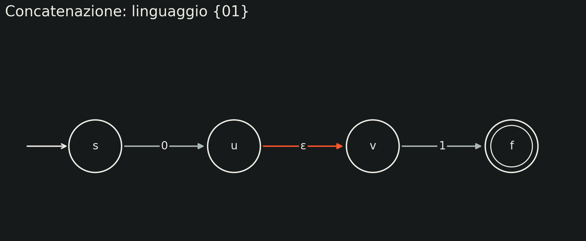
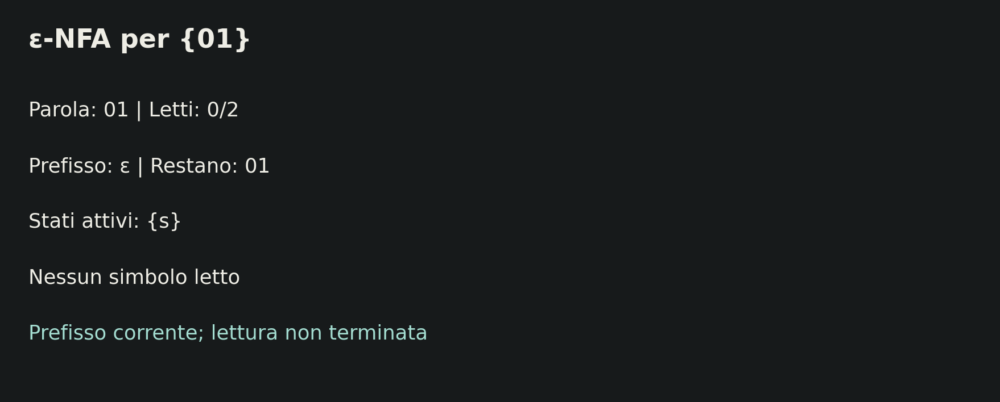
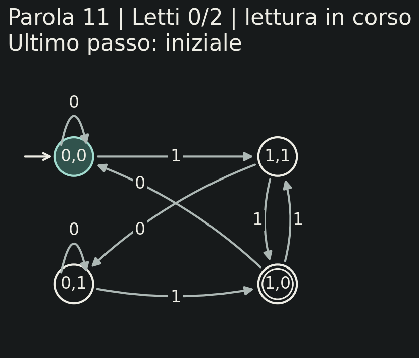

## Linguaggi regolari e problemi di decisione {#scena-01 .scrollable}

<p class="scene-meta">01 / 43 · Cap. 2 · pp. 23-24</p>

**VVT · Lezione 2 · Capitolo 2**

**Obiettivo:** costruire automi, decidere inclusioni e spiegare la memoria minima.

**Percorso:** espressioni → automi → raggiungibilità → Myhill–Nerode.

## Richiamo: accettazione su parole finite {#scena-02 .scrollable}

<p class="scene-meta">02 / 43 · Cap. 2 · introduzione, pp. 23-24</p>

Un DFA ha una sola run; un NFA può averne più di una.

Una parola è accettata se **almeno una run** termina in uno stato finale, dopo aver consumato tutto l'input.

$$ L(\mathcal A)\subseteq\Sigma^* $$

Useremo $\Sigma=\{0,1\}$. La parola vuota è $\varepsilon$; il complemento è sempre relativo all'alfabeto dichiarato.

## Sintassi delle espressioni regolari {#scena-03 .scrollable}

<p class="scene-meta">03 / 43 · Cap. 2 · §2.1.1, pp. 24-25</p>

Le espressioni **ristrette** partono da:

$$ \varnothing,\qquad \varepsilon,\qquad a\in\Sigma $$

Se $r$ e $s$ sono espressioni, anche $r+s$, $rs$ e $r^*$ lo sono.

Il simbolo $+$ indica **unione**. La stella ha precedenza sulla concatenazione, che precede l'unione; le parentesi eliminano ambiguità.

## Semantica delle espressioni regolari {#scena-04 .scrollable}

<p class="scene-meta">04 / 43 · Cap. 2 · §2.1.1, pp. 24-25</p>

$$ L(\varnothing)=\varnothing,\quad L(\varepsilon)=\{\varepsilon\},\quad L(a)=\{a\} $$

$$ L(r+s)=L(r)\cup L(s) $$

$$ L(rs)=L(r)L(s),\qquad L(r^*)=L(r)^* $$

$\varnothing$ non contiene parole; $\varepsilon$ descrive una parola di lunghezza zero. La stella consente sempre zero ripetizioni.

## Espressioni per suffisso e parità {#scena-05 .scrollable}

<p class="scene-meta">05 / 43 · Cap. 2 · §2.1.1, p. 25</p>

$$ (0+1)^*01 $$

Descrive le parole che terminano con `01`: accetta `01`, `1101`; rifiuta `ε`, `010`.

$$ 0^*(10^*10^*)^* $$

Descrive le parole con un numero pari di `1`: ogni blocco ripetuto contribuisce due `1`. Sono incluse `ε` e tutte le parole composte solo da `0`.

## Espressioni generali e star-free {#scena-06 .scrollable}

<p class="scene-meta">06 / 43 · Cap. 2 · §2.1.1, pp. 25-26</p>

Le espressioni **generali** aggiungono intersezione e complemento:

$$ L(r\cap s)=L(r)\cap L(s),\qquad L(\overline r)=\Sigma^*\setminus L(r) $$

Le espressioni **star-free** ammettono questi operatori booleani, ma non la stella.

Star-free non significa linguaggio finito: $\overline{\varnothing}$ descrive $\Sigma^*$. Le espressioni generali hanno la stessa potenza delle ristrette; le star-free ne hanno meno.

## Transizioni ε e composizione {#scena-07 .scrollable}

<p class="scene-meta">07 / 43 · Cap. 2 · §2.1.2, pp. 26-27</p>

Una transizione $\varepsilon$ cambia stato **senza consumare simboli**. Non aggiunge un simbolo all'alfabeto.

Per concatenare gli automi per `0` e `1`, colleghiamo l'uscita del primo all'ingresso del secondo. Solo l'ultima uscita resta accettante.

Il doppio cerchio indica uno stato finale; la freccia esterna indica l'iniziale.

{.lesson-figure}

## Chiusura ε come punto fisso {#scena-08 .scrollable}

<p class="scene-meta">08 / 43 · Cap. 2 · §2.1.2, p. 27</p>

$\operatorname{ECl}(S)$ contiene tutti gli stati raggiungibili da $S$ usando zero o più transizioni ε.

$$ X_0=S,\qquad X_{i+1}=X_i\cup\bigcup_{q\in X_i}\Delta(q,\varepsilon) $$

Si arresta quando $X_{i+1}=X_i$. Nel diagramma precedente:

$$ \operatorname{ECl}(\{u\})=\{u,v\} $$

Lo stato di partenza appartiene sempre alla propria chiusura.

## Simulazione di un ε-NFA {#scena-09 .scrollable}

<p class="scene-meta">09 / 43 · Cap. 2 · §2.1.2, pp. 27-28</p>

Prima di leggere e dopo ogni simbolo, calcoliamo la chiusura ε.

1. In **Parola** scegli `01`; **Letti** conta i simboli consumati, da `0` a `2`, inizialmente `0`.
2. A `0` l'insieme attivo è `{s}`. A `1` diventa `{u,v}`: è stato consumato solo `0`.
3. A `2` rimane `{f}` e la parola è accettata.
4. Scegli `0`: il cursore si azzera e il massimo diventa `1`. Al termine `{u,v}` non contiene finali.

Il caso `ε` termina subito in `{s}` ed è rifiutato.

{.lesson-figure}

## Eliminare le transizioni ε {#scena-10 .scrollable}

<p class="scene-meta">10 / 43 · Cap. 2 · §2.1.2, pp. 29-30</p>

Manteniamo gli stati, ma ogni passo ordinario assorbe i passi ε precedenti e successivi:

$$ \Delta'(q,a)=\operatorname{ECl}\left(\bigcup_{p\in\operatorname{ECl}(\{q\})}\Delta(p,a)\right) $$

Nell'esempio: $\Delta'(s,0)=\{u,v\}$ e $\Delta'(u,1)=\{f\}$.

Il nuovo NFA legge solo simboli reali. Va controllata separatamente l'accettazione della parola vuota.

## Eliminazione ε: il caso della parola vuota {#scena-11 .scrollable}

<p class="scene-meta">11 / 43 · Cap. 2 · §2.1.2, pp. 29-30</p>

Con la convenzione precedente manteniamo $F$, aggiungendo $q_0$ se la sua chiusura ε incontra $F$.

**Esempio:** due stati `i`, `f`, con una sola freccia ε da `i` a `f`; solo `f` è finale.

L'automa accetta `ε`. Eliminando la freccia senza correggere i finali, la rifiuterebbe.

Rendendo finale anche `i`, il linguaggio rimane esattamente $\{\varepsilon\}$.

```python
empty_example = enfa({'i','f'}, {('i', EPS): {'f'}}, 'i', {'f'})
ordinary = remove_epsilon(empty_example)
print('Finali dopo la rimozione:', names(ordinary['final']))
print('ε accettata:', bool(enfa_run(ordinary, '')[-1] & ordinary['final']))
print('0 accettata:', bool(enfa_run(ordinary, '0')[-1] & ordinary['final']))
```

```
Finali dopo la rimozione: {f, i}
ε accettata: True
0 accettata: False
```

## Teorema di Kleene: le due costruzioni {#scena-12 .scrollable}

<p class="scene-meta">12 / 43 · Cap. 2 · §2.1.3, pp. 30-32</p>

Un linguaggio su parole finite è riconosciuto da un automa finito **se e solo se** è descritto da un'espressione regolare ristretta.

- **Espressione → automa:** costruzione strutturale di Thompson.
- **Automa → espressione:** ricorrenza sui possibili stati intermedi.

Entrambe sono procedure effettive. Si può passare da ε-NFA a NFA, poi a DFA, conservando il linguaggio.

## Thompson: casi base e invariante {#scena-13 .scrollable}

<p class="scene-meta">13 / 43 · Cap. 2 · §2.1.3, pp. 34-35</p>

Ogni frammento ha un ingresso e una sola uscita accettante, inizialmente priva di archi uscenti.

- $\varnothing$: ingresso e uscita senza un cammino che li colleghi.
- $\varepsilon$: un arco ε dall'ingresso all'uscita.
- $a$: un arco etichettato $a$ dall'ingresso all'uscita.

I frammenti da comporre devono avere insiemi di stati disgiunti.

## Thompson: unione, concatenazione e stella {#scena-14 .scrollable}

<p class="scene-meta">14 / 43 · Cap. 2 · §2.1.3, pp. 34-35</p>

**Unione $r+s$:** un nuovo ingresso sceglie con ε uno dei due frammenti; le vecchie uscite raggiungono una nuova uscita.

**Concatenazione $rs$:** colleghiamo l'uscita di $r$ all'ingresso di $s$ con ε.

**Stella $r^*$:** aggiungiamo ingresso e uscita nuovi; consentiamo di saltare il frammento, attraversarlo, ripeterlo e uscire.

Il salto diretto ingresso → uscita realizza le zero ripetizioni.

## Compilare un’espressione in Python {#scena-15 .scrollable}

<p class="scene-meta">15 / 43 · Cap. 2 · §2.1.3, pp. 34-35</p>

Compiliamo $r=(0+1)^*01$ e poi rimuoviamo ε e determinizziamo.

Il codice rappresenta la sintassi con tuple: `lit` è un simbolo, `plus` è unione, `cat` è concatenazione, `star` è stella.

La prova finita confronta il DFA con la proprietà «termina con `01`». La correttezza generale deriva dalla costruzione di Thompson.

```python
zero, one = ('lit','0'), ('lit','1')
regex = ('cat', ('star', ('plus', zero, one)), ('cat', zero, one))
compiled_e = thompson(regex)
compiled_d = determinize(remove_epsilon(compiled_e))
for w in words():
    assert accepts(compiled_d, w) == w.endswith('01')
print('Stati ε-NFA:', len(compiled_e['states']))
print('Stati DFA raggiungibili:', len(compiled_d['states']))
print('255 parole confrontate con il predicato del suffisso.')
```

```
Stati ε-NFA: 12
Stati DFA raggiungibili: 4
255 parole confrontate con il predicato del suffisso.
```

## Da automa a espressione: stati intermedi {#scena-16 .scrollable}

<p class="scene-meta">16 / 43 · Cap. 2 · §2.1.3, pp. 32-33</p>

Numeriamo gli stati $q_1,\ldots,q_n$.

$R_{ij}^{k}$ descrive le parole dei cammini da $q_i$ a $q_j$ che usano come stati **intermedi** solo $q_1,\ldots,q_k$.

Gli estremi non sono vincolati. Con $k=0$ sono ammessi solo archi diretti e il cammino vuoto da uno stato a sé stesso.

Quindi $R_{ij}^{0}$ è l'unione delle etichette dirette, con ε aggiunta quando $i=j$.

## Ricorrenza per la traduzione in espressione {#scena-17 .scrollable}

<p class="scene-meta">17 / 43 · Cap. 2 · §2.1.3, pp. 33-36</p>

Sbloccando $q_k$ come nuovo stato intermedio, un cammino può evitarlo oppure entrarvi, ritornarvi e uscire.

$$ R_{ij}^{k}=R_{ij}^{k-1}+R_{ik}^{k-1}(R_{kk}^{k-1})^*R_{kj}^{k-1} $$

La stella rappresenta un numero finito qualsiasi di ritorni.

Alla fine si uniscono $R_{1j}^{n}$ per tutti i finali $q_j$, assumendo $q_1$ iniziale.

## Ricorrenza sul DFA della parità {#scena-18 .scrollable}

<p class="scene-meta">18 / 43 · Cap. 2 · §2.1.3, pp. 33-34</p>

Nel DFA della parità di `1`, $q_1$ è pari e $q_2$ dispari. `0` conserva lo stato, `1` lo cambia.

$$ R_{11}^{0}=R_{22}^{0}=\varepsilon+0,\qquad R_{12}^{0}=R_{21}^{0}=1 $$

Sbloccando $q_1$:

$$ R_{22}^{1}=(\varepsilon+0)+1(\varepsilon+0)^*1 $$

Sono inclusi `ε`, `0`, `11`, `101`; `00` richiede un passaggio intermedio per $q_2$ e non è ancora incluso.

## Chiusure dei linguaggi regolari {#scena-19 .scrollable}

<p class="scene-meta">19 / 43 · Cap. 2 · §2.2, pp. 36-37</p>

Se $L_1$ e $L_2$ sono regolari sullo stesso alfabeto, sono regolari anche:

$$ L_1\cup L_2,\quad L_1L_2,\quad L_1^*,\quad \overline{L_1},\quad L_1\cap L_2 $$

Unione, concatenazione e stella seguono dalle costruzioni già viste.

Complemento e intersezione permettono di combinare requisiti. Con Kleene, dimostrano che gli operatori delle espressioni generali non aggiungono potere espressivo.

## Complemento: serve un DFA completo {#scena-20 .scrollable}

<p class="scene-meta">20 / 43 · Cap. 2 · §2.2.1, pp. 37-38</p>

Per un DFA completo basta sostituire $F$ con $Q\setminus F$.

Ogni parola ha esattamente una run completa: il suo verdetto viene invertito.

**DFA parziale per `{1}`:** solo `s —1→ f`, con `f` finale. Scambiando i finali si accetta solo `ε`: `0` continua a non avere run.

Prima bisogna aggiungere uno stato pozzo e tutte le transizioni mancanti.

## Perché lo scambio dei finali fallisce su un NFA {#scena-21 .scrollable}

<p class="scene-meta">21 / 43 · Cap. 2 · §2.2.1, pp. 37-38</p>

Considera un NFA con iniziale `s`, finale `f`, e transizioni:

- da `s`, con `0`, resta in `s`;
- da `s`, con `1`, può restare in `s` oppure andare in `f`;
- da `f`, con `0` o `1`, resta in `f`.

Accetta le parole che contengono `1`. Dopo lo scambio accetta ancora `1` tramite il ramo che resta in `s`.

Procedura corretta: **determinizzare → completare → scambiare**.

## Intersezione mediante prodotto {#scena-22 .scrollable}

<p class="scene-meta">22 / 43 · Cap. 2 · §2.2.2, pp. 38-39</p>

Lo stato del prodotto è una coppia: ricorda entrambi gli stati raggiunti dopo lo stesso prefisso.

$$ \delta((p,q),a)=(\delta_1(p,a),\delta_2(q,a)) $$

Per l'intersezione, lo stato iniziale è $(q_{01},q_{02})$ e i finali sono:

$$ F=F_1\times F_2 $$

Entrambi i componenti devono accettare **al termine della stessa parola**.

## Simulazione del prodotto {#scena-23 .scrollable}

<p class="scene-meta">23 / 43 · Cap. 2 · §2.2.2, pp. 38-39</p>

Primo componente: `1` se il prefisso termina con `1`, altrimenti `0`. Secondo: `0` se il numero di `1` è pari, `1` se dispari. Solo `(1,0)` è finale.

1. Scegli **Parola** `11`; **Letti** va da `0` a `2`, inizialmente `0`.
2. A `1` compare `(1,1)`; a `2` compare `(1,0)`: accettata.
3. Scegli `110`: Letti torna a `0`, massimo `3`. A `3` compare `(0,0)`: rifiutata.

`ε` parte e termina in `(0,0)`, quindi è rifiutata. La parità da sola non basta.

{.lesson-figure}

## Comporre requisiti per l’editor {#scena-24 .scrollable}

<p class="scene-meta">24 / 43 · Cap. 2 · §2.2, p. 37</p>

Riprendiamo l'alfabeto di eventi `apri`, `modifica`, `salva`, `chiudi`.

$$ r_{\mathrm{sessione}}=\mathrm{apri}\;(\mathrm{modifica}+\mathrm{salva})^*\;\mathrm{chiudi} $$

Il requisito «contiene almeno un salvataggio» è $\Sigma^*\;\mathrm{salva}\;\Sigma^*$.

Il prodotto accetta le sessioni ordinate con almeno un salvataggio. Una parola più corta possibile è `apri, salva, chiudi`.

Questo requisito non impone di salvare ogni modifica.

## Problemi di decisione su automi {#scena-25 .scrollable}

<p class="scene-meta">25 / 43 · Cap. 2 · §2.3, pp. 39-40</p>

- **Appartenenza:** questa parola è accettata?
- **Vuotezza:** esiste almeno una parola accettata?
- **Universalità:** sono accettate tutte le parole di $\Sigma^*$?
- **Inclusione:** ogni parola di $L_1$ appartiene a $L_2$?
- **Equivalenza:** i due linguaggi coincidono?

L'appartenenza usa la simulazione. Per la vuotezza basta chiedere se un finale è raggiungibile dall'iniziale.

## Ricerca in ampiezza e parola testimone {#scena-26 .scrollable}

<p class="scene-meta">26 / 43 · Cap. 2 · §2.3, pp. 40-41</p>

Una BFS esplora gli stati per distanza dall'iniziale. Memorizziamo, per ogni stato nuovo, predecessore e simbolo usato.

Appena raggiungiamo un finale, ricostruiamo una parola accettata di lunghezza minima.

**Attenzione al risultato:** `None` significa linguaggio vuoto; `''` significa che `ε` è un testimone.

```python
for label, machine in [('prodotto', PAIR), ('parità', PARITY)]:
    witness = shortest_witness(machine)
    print(label, '→', 'linguaggio vuoto' if witness is None else shown(witness))
impossible = dfa_product(ENDS, complement(CONTAINS))
assert shortest_witness(impossible) is None
print('Termina con 1 e non contiene 1 → linguaggio vuoto')
```

```
prodotto → 11
parità → ε
Termina con 1 e non contiene 1 → linguaggio vuoto
```

## Proprietà del testimone corto {#scena-27 .scrollable}

<p class="scene-meta">27 / 43 · Cap. 2 · §2.3, pp. 40-41</p>

Un DFA con $n$ stati ha linguaggio non vuoto se e solo se accetta una parola $w$ con:

$$ |w|<n $$

In una run accettante minima nessuno stato si ripete: il tratto fra due visite allo stesso stato potrebbe essere eliminato.

Quindi la run contiene al massimo $n$ stati e la parola al massimo $n-1$ simboli.

## Raggiungibilità come punto fisso {#scena-28 .scrollable}

<p class="scene-meta">28 / 43 · Cap. 2 · §2.3.1, pp. 41-42</p>

$\operatorname{Post}(R)$ contiene i successori in un passo degli stati in $R$.

$$ R_0=\{q_0\},\qquad R_{i+1}=R_i\cup\operatorname{Post}(R_i) $$

$R_i$ raccoglie gli stati raggiungibili con parole di lunghezza **al massimo** $i$. Il primo insieme stabile $R^*$ contiene tutti gli stati raggiungibili.

$$ L(\mathcal A)\ne\varnothing\quad\Longleftrightarrow\quad R^*\cap F\ne\varnothing $$

## Esplorazione del punto fisso {#scena-29 .scrollable}

<p class="scene-meta">29 / 43 · Cap. 2 · §2.3.1, pp. 41-42</p>

Il DFA ricorda quanti `1` consecutivi chiudono il prefisso: `0`, `1`, `2`; `3` significa che `111` è già comparso e resta assorbente. Solo `3` è finale.

**Iterazione** seleziona $R_i$: valori da `0` a `4`, inizialmente `0`.

1. A `1`, $R_1=\{0,1\}$; a `2`, $R_2=\{0,1,2\}$.
2. A `3` compare il finale `3`: il linguaggio è non vuoto, testimone `111`.
3. A `4` non cambia nulla: il punto fisso è raggiunto.

Prima di `3`, non avere ancora trovato un finale non prova la vuotezza.

{.lesson-figure}

## Riduzioni alla vuotezza {#scena-30 .scrollable}

<p class="scene-meta">30 / 43 · Cap. 2 · §2.3.1, p. 42</p>

Le chiusure trasformano le domande sui linguaggi in ricerca di testimoni:

$$ L_1\subseteq L_2\quad\Longleftrightarrow\quad L_1\cap\overline{L_2}=\varnothing $$

$$ L=\Sigma^*\quad\Longleftrightarrow\quad\overline L=\varnothing $$

L'equivalenza richiede entrambe le inclusioni. In alternativa, cerchiamo una parola accettata da uno solo dei due automi.

Per l'inclusione, ogni parola del prodotto con il complemento è un **controesempio concreto**.

## Inclusione e controesempio eseguibile {#scena-31 .scrollable}

<p class="scene-meta">31 / 43 · Cap. 2 · §2.3.1, p. 42</p>

Siano $L_E$ le parole che terminano con `1` e $L_C$ quelle che contengono `1`.

$L_E\subseteq L_C$: il prodotto con il complemento di $L_C$ non ha finali raggiungibili.

Il verso opposto fallisce: `10` contiene `1`, ma non termina con `1`.

La BFS trova un testimone minimo della violazione; non esamina un insieme di test scelti a mano.

```python
for label, left, right in [('E ⊆ C', ENDS, CONTAINS), ('C ⊆ E', CONTAINS, ENDS)]:
    bad = dfa_product(left, complement(right))
    witness = shortest_witness(bad)
    print(label, '→', 'vera' if witness is None else 'falsa, controesempio: '+shown(witness))
    if witness is not None:
        assert accepts(left, witness) and not accepts(right, witness)
```

```
E ⊆ C → vera
C ⊆ E → falsa, controesempio: 10
```

## Costo delle procedure e rappresentazione {#scena-32 .scrollable}

<p class="scene-meta">32 / 43 · Cap. 2 · §2.3 e collegamento con §1.4, pp. 39-42</p>

Su un grafo esplicito con $n$ stati e $m$ archi, la BFS costa $O(n+m)$.

Per due DFA, un prodotto ha al massimo $n_1n_2$ stati; si possono esplorare solo quelli raggiungibili.

Per gli NFA, complemento, inclusione ed equivalenza possono richiedere la determinizzazione, con fino a $2^n$ sottoinsiemi.

«Riducibile a raggiungibilità» non significa avere sempre un grafo piccolo.

## Equivalenze, classi e indice {#scena-33 .scrollable}

<p class="scene-meta">33 / 43 · Cap. 2 · §2.4, pp. 43-44</p>

Una relazione di equivalenza è riflessiva, simmetrica e transitiva. Le sue classi formano una partizione: non si sovrappongono e coprono tutto l'insieme.

L'**indice** è il numero delle classi.

Esempio: raggruppare le parole per parità della lunghezza dà due classi.

«Condividono un simbolo» non è transitiva: `0` condivide con `01`, `01` con `1`, ma `0` non condivide con `1`.

## Invarianza a destra e compatibilità {#scena-34 .scrollable}

<p class="scene-meta">34 / 43 · Cap. 2 · §2.4, pp. 44-46</p>

Per rappresentare classi di prefissi come stati servono due proprietà.

**Invarianza a destra:**

$$ x\sim y\quad\Longrightarrow\quad xz\sim yz\quad\text{per ogni }z\in\Sigma^* $$

**Compatibilità con $L$:** prefissi nella stessa classe appartengono entrambi a $L$, oppure entrambi ne sono fuori.

La prima rende coerenti le transizioni; la seconda rende coerente il verdetto.

## Equivalenza di Myhill–Nerode {#scena-35 .scrollable}

<p class="scene-meta">35 / 43 · Cap. 2 · §2.4, pp. 45-46</p>

Due prefissi sono equivalenti per $L$ quando nessuna continuazione distingue i loro verdetti:

$$ x\sim_L y\quad\Longleftrightarrow\quad\forall z\in\Sigma^*:\;(xz\in L\Longleftrightarrow yz\in L) $$

Per il linguaggio «termina con `1`», `01` e `11` sono equivalenti.

`0` e `01` sono distinti: basta $z=\varepsilon$. Accettare o rifiutare entrambi **adesso** non garantisce invece che due prefissi siano equivalenti.

## Confrontare i futuri di due prefissi {#scena-36 .scrollable}

<p class="scene-meta">36 / 43 · Cap. 2 · §2.4, pp. 45-46</p>

Usiamo il linguaggio «numero pari di `1`».

**Coppia** seleziona `ε / 1`, `1 / 01` o `ε / 11`, inizialmente `ε / 1`. **Suffisso** seleziona `ε`, `0`, `1`, `01`, inizialmente `ε`.

1. Con `ε / 1` e suffisso `ε`, i verdetti differiscono: i prefissi sono distinguibili.
2. Scegli `1 / 01` mantenendo `ε`: entrambi rifiutano. Con suffisso `1`, entrambi accettano.
3. I due prefissi restano equivalenti per **ogni** suffisso perché hanno la stessa parità, non perché abbiamo provato quattro casi.

{.lesson-figure}

## Teorema di Myhill–Nerode {#scena-37 .scrollable}

<p class="scene-meta">37 / 43 · Cap. 2 · §2.4, pp. 45-47</p>

Per $L\subseteq\Sigma^*$ sono equivalenti:

1. $L$ è regolare.
2. Esiste un'equivalenza di indice finito, invariante a destra e compatibile con $L$.
3. L'equivalenza $\sim_L$ ha indice finito.

Un DFA fornisce una classificazione finita dei prefissi. Myhill–Nerode conserva soltanto le distinzioni che qualche continuazione può osservare.

## Costruire il DFA delle classi {#scena-38 .scrollable}

<p class="scene-meta">38 / 43 · Cap. 2 · §2.4, p. 47</p>

Se $\sim_L$ ha indice finito, usiamo le sue classi come stati.

- Stato iniziale: $[\varepsilon]$.
- Transizione: $\delta([w],a)=[wa]$.
- Classe accettante: $[w]$ con $w\in L$.

L'invarianza a destra rende la transizione indipendente dal rappresentante. La compatibilità rende ben definito l'insieme dei finali.

Dopo aver letto $w$, lo stato è $[w]$: il DFA riconosce esattamente $L$.

## Minimalità del DFA delle classi {#scena-39 .scrollable}

<p class="scene-meta">39 / 43 · Cap. 2 · §2.4, pp. 47-48</p>

Se due prefissi appartengono a classi di Myhill–Nerode diverse, un suffisso li distingue. Qualunque DFA per $L$ deve quindi portarli in stati diversi.

Ogni DFA per $L$ ha almeno tanti stati quante sono le classi di $\sim_L$. Il DFA delle classi raggiunge questo limite.

Per «termina con `1`» ci sono due classi: prefissi che terminano con `1` e tutti gli altri, inclusa `ε`. Due stati sono necessari e sufficienti.

## Non regolarità mediante prefissi distinguibili {#scena-40 .scrollable}

<p class="scene-meta">40 / 43 · Cap. 2 · §2.4, p. 43 e applicazione del teorema, pp. 45-47</p>

Considera il linguaggio delle parole con tanti `0` quanti `1`.

Prendiamo i prefissi $x_n=0^n$, per ogni $n\geq0$.

Se $m\ne n$, il suffisso $z=1^n$ distingue $x_n$ da $x_m$:

$$ 0^n1^n\in L,\qquad 0^m1^n\notin L $$

Esistono infinite classi di Myhill–Nerode. Dunque il linguaggio non è regolare, anche se il suo predicato di appartenenza è facile da calcolare.

## Esercizi di autoverifica {#scena-41 .scrollable}

<p class="scene-meta">41 / 43 · Cap. 2 · Esercizi, pp. 48-49</p>

1. Che linguaggi descrivono $\varnothing^*$ e $\varepsilon+01$?
2. Due stati, iniziale e finale, sono collegati solo da ε: che correzione conserva l'accettazione della parola vuota dopo la rimozione ε?
3. Trova la parola minima che termina con `1` e contiene un numero pari di `1`.
4. Per il linguaggio «contiene `1`», `ε` e `0` sono equivalenti? E `ε` e `1`?
5. Quale prodotto verifica $L_C\subseteq L_E$ e quale controesempio trova?

Spiega a voce le ragioni prima di passare alle soluzioni.

## Soluzioni e verifica degli algoritmi {#scena-42 .scrollable}

<p class="scene-meta">42 / 43 · Cap. 2 · Esercizi, pp. 48-49</p>

1. $\varnothing^*$ descrive $\{\varepsilon\}$; $\varepsilon+01$ descrive $\{\varepsilon,01\}$.
2. Con la nostra formula per $\Delta'$, rendiamo finale anche l'iniziale.
3. `11`: un solo `1` dà parità dispari.
4. `ε` e `0` hanno gli stessi futuri; `ε` e `1` sono distinti già dal suffisso vuoto.
5. Prodotto di $C$ con il complemento di $E$: testimone minimo `10`.

Il controllo seguente confronta costruzioni e predicati su tutte le 255 parole binarie fino a lunghezza 7.

```python
print('Verifica completata: 255 parole e 10 espressioni.')
print('ε-NFA, rimozione ε e DFA concordano con i predicati diretti.')
print('BFS, inclusioni, testimone vuoto e punto fisso: controlli passati.')
```

```
Verifica completata: 255 parole e 10 espressioni.
ε-NFA, rimozione ε e DFA concordano con i predicati diretti.
BFS, inclusioni, testimone vuoto e punto fisso: controlli passati.
```

## Riepilogo e collegamento alla verifica {#scena-43 .scrollable}

<p class="scene-meta">43 / 43 · Cap. 2 · Riepilogo, p. 48</p>

- Espressioni regolari e automi finiti descrivono gli stessi linguaggi.
- Le transizioni ε rendono modulari le costruzioni e si possono eliminare.
- Complemento e prodotto compilano requisiti booleani.
- L'inclusione si decide cercando un comportamento ammesso dal sistema e vietato dalla specifica.
- Myhill–Nerode identifica la memoria minima necessaria.

Nel capitolo 3 passeremo alle parole infinite: il momento finale di accettazione non sarà più disponibile.
